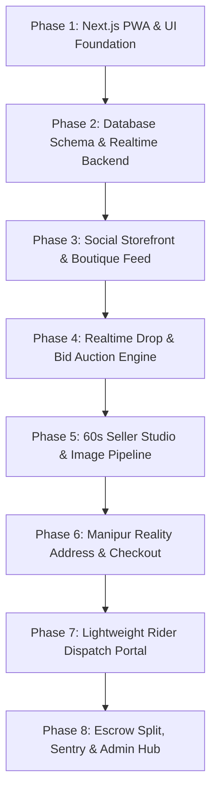
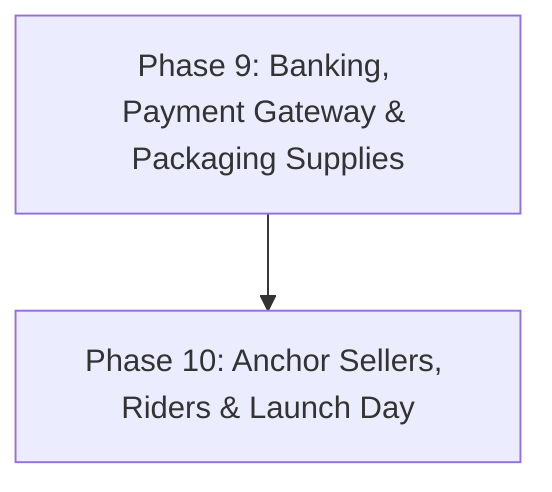

# Shinyen (ꯁꯤꯟꯌꯦꯟ): Master Step-by-Step Implementation Plan

> **Blueprint Hierarchy**: 
> 1. **Part A (Phases 1 – 8)**: Software Engineering, Codebase & Cloud Architecture *(Executed by AI Assistant inside the computer)*.
> 2. **Part B (Phases 9 – 10)**: Real-World Business, Banking, Fleet & On-Ground Operations *(Executed by Founder outside the computer)*.
> **Architecture Status**: Hardened and verified via Gemini 4 Argon Distributed Systems Audit (`gemini-4-argon`).

---

# Part A: Software Engineering & Platform Build (AI Execution)

---

## Phase 1: Project Initialization & Modern PWA Design System
*Goal: Establish the high-performance Next.js 14/15 foundation with native-app feel, fluid animations, and PWA capabilities.*

- [x] **Task 1.1**: Initialize Next.js 14/15 App Router with TypeScript, Tailwind CSS, Lucide icons, and `shadcn/ui` primitives.
  - Enforce `LazyMotion` with `domAnimation` instead of importing full `framer-motion` (~15KB vs 34KB gzipped).
  - Prohibit `layout` prop animations on catalog product cards to protect 60fps scrolling on budget Helio G25/Unisoc devices (Redmi 9A, Realme C-series).
- [x] **Task 1.2**: Configure PWA engine via `@serwist/next` with `manifest.json`, theme colors (`#0F172A`), standalone mobile display, and offline catalog caching.
  - Add Instagram In-App Browser (IAB) detection helper (`useEnvironment()`) with intent deep-link breakout (`intent://...#Intent;scheme=https;package=com.android.chrome;end`) so Google 1-Tap never fails due to WebView cookie partitioning.
- [x] **Task 1.3**: Integrate **Vaul** for buttery-smooth iOS-style pull-up bottom drawers (for checkout, bidding, and filters).
- [x] **Task 1.4**: Create mobile haptic vibration utility (`navigator.vibrate(10)`) and skeleton shimmer loading placeholders.
- [x] **Task 1.5**: Set up **Sentry for Next.js** for real-time error tracking, device profiling (Redmi/Realme/iPhone), and the in-app user feedback/bug report modal.
  - Configure lazy-loading for the Feedback Modal (`import('@sentry/nextjs')` on button tap) to keep First-Load JS strictly `< 130KB gzipped`.

---

## Phase 2: Database Architecture, Security & Mock Data (Supabase / Postgres)
*Goal: Build the relational data models, security rules, and atomic concurrency procedures.*

- [x] **Task 2.1**: Configure Supabase PostgreSQL connection with strict TypeScript schema definitions.
- [x] **Task 2.2**: Implement core and Argon-hardened tables:
  - `profiles`, `products`, `auctions`, `bids`, `orders`, `disputes`, `payouts`, `stories`, `follows`.
  - `auction_offers` (cleanly isolates the 3-hour winner & runner-up checkout window before creating an order row).
  - `banned_identities` (stores salted SHA-256 hashes of phone numbers and UPI VPAs to stop banned users from resetting strikes via account deletion).
  - `drop_reminders` & `community_fit_checks` (powers reminder stickers and "Worn by Community" gallery).
  - `leikais` (stores crowdsourced locality additions in Postgres with Edge caching).
- [x] **Task 2.3**: Write Row-Level Security (RLS) policies guaranteeing role-based data isolation:
  - Wrap all `auth.uid()` calls in `(SELECT auth.uid())` for 95% faster cached execution.
  - Sync user roles into JWT `app_metadata` to eliminate cross-table joins during policy checks.
- [x] **Task 2.4**: Create the Atomic `place_bid()` PL/pgSQL Stored Procedure:
  - Acquires explicit row write-lock on `auctions` via `SELECT ... FOR UPDATE` with `SET LOCAL lock_timeout = '1500ms'`.
  - Serializes concurrent bids cleanly; rejects stale target bids in `< 1ms`.
  - Implements High-Water Mark anti-sniping reset: `clock_timestamp() + INTERVAL '120 seconds'` if bid lands in final 60 seconds (prevents clock stacking).
- [x] **Task 2.5**: Seed database with 15 rich mock items across Manipur's 3 launch industries:
  - *Curated Thrift*: Vintage bomber jackets, Japanese denim, Y2K aesthetic tops.
  - *Handcrafted Jewellery*: Resin floral earrings, clay studs, beadwork necklaces.
  - *Traditional Handloom*: Authentic *Rani Phi*, *Moirang Phee*, *Phanek Mayek Naibi*.

---

## Phase 3: The Social Storefront & "Instagram Feel" (Buyer Experience)
*Goal: Build the vibrant, visual discovery engine that mimics the energy of social commerce.*

- [x] **Task 3.1**: Build the **Boutique Stories / Status Carousel** at the top of the homepage:
  - Gradient ring avatars indicating `✨ New Drop`, `🔥 Live Auction`, and `🧵 Artisan Weaving`.
  - Full-screen story viewer with interactive stickers: `[ ⚡ View Item & Bid ]` and `[ 🔔 Set Drop Reminder ]`.
- [x] **Task 3.2**: Build the 3 Curated Homepage Category Tabs:
  - `[ 👗 Curated Thrift ]`, `[ 💎 Handcrafted Jewellery ]`, and `[ 🥻 Traditional Handloom ]`.
- [x] **Task 3.3**: Build Product Detail Page:
  - Deliver Day-0 14KB thumbnail (`thumb_20kb.webp`) on feed cards; load 160KB full gallery WebP on swipe carousel.
  - On-Demand ISR (`revalidateTag`) for immediate `⚡ SOLD OUT` rendering at CDN speed on direct Instagram links.
  - Industry-smart sizing cards: Handloom (`Free Size / Unstitched`), Jewellery (`Standard`), Thrift (`S/M/L/XL` with optional `📐 Verified Fit` chest/length badge).
  - Natural thrift flaw disclosure note + flaw close-up photo.
  - Followable boutique card with `[ + Follow ]` button and verified sales counter.
- [x] **Task 3.4**: Build the Boutique Vanity Profile (`/@handle`):
  - 3-column aesthetic photo grid, bio, badges, and a **"Worn by Community"** fit-check customer photo gallery.
- [x] **Task 3.5**: Build Drop Teaser listings with active countdown timers and `[ 🔔 Remind Me ]` alert subscriptions.

---

## Phase 4: The Real-Time "Drop & Bid" Auction Engine
*Goal: Provide sub-second bidding wars, dynamic clock extensions, and automated settlement.*

- [x] **Task 4.1**: Connect **Supabase Realtime Broadcast** (multiplexed channel `sunday_drop_stream`) delivering sub-80ms updates while bypassing the 200-WebSocket ceiling.
  - Build automatic 3-second Edge-cached HTTP polling fallback (`/api/auctions/[id]/state` with `s-maxage=1, stale-while-revalidate=2`) if WebSockets hit limits.
- [x] **Task 4.2**: Implement Monotonic Hardware Clock Sync:
  - Broadcasts `server_epoch_ms` with every bid; client timers compute countdowns using `performance.now() + serverOffsetMs` to eliminate phone clock drift.
- [x] **Task 4.3**: Build 1-Tap Quick Bid buttons (`+₹50`, `+₹100`, `+₹200`) sending explicit target prices (`proposed_amount = displayed_price + 50`), not relative increments.
- [x] **Task 4.4**: Implement the **Zero-Cost Inbound WhatsApp Verification Gate**:
  - Before a user places their first bid, deep-link to WhatsApp with pre-filled token (`VERIFY-SHN-...`) sent to Lookmai's WhatsApp Business number. Free inbound webhook verified by Meta.
  - Cap first-time buyers (`completed_orders = 0`) at a maximum of 2 concurrent live leading bids.
- [x] **Task 4.5**: Implement the 3-Hour Auto-Checkout Background Worker:
  - Scans ended auctions; generates pending offer in `auction_offers` with a 3-hour payment deadline.
  - *Anti-Collusion Roll-Down Protocol*: Auto-rolls down to 2nd bidder *if* within 25% of winning bid; otherwise routes to Seller Control Hub for 1-tap decision (Offer to 2nd, Re-Drop, or Convert to Buy Now).

---

## Phase 5: The "60-Second Mobile Seller Studio" (`/seller`)
*Goal: Allow micro-sellers to list items from their phone faster than typing an Instagram caption.*

- [x] **Task 5.1**: Build sequential client-side image compression pipeline using `browser-image-compression`:
  - Compresses images strictly sequentially (`for...of` loop) to prevent canvas RAM exhaustion on 2GB RAM phones.
  - **Day-0 Dual Output**: Generates both a tiny 14KB thumbnail (`thumb_20kb.webp` at 320px) and full-size WebP photos (`gallery_1..5.webp` at 1440px, < 180KB).
- [x] **Task 5.2**: Connect **Cloudflare R2** storage via secure pre-signed upload URLs:
  - Cryptographically bind `ContentLength` (< 350KB for images, < 50MB for dispute videos) and `ContentType` into S3v4 signatures with 120-second expiry to prevent storage abuse.
- [x] **Task 5.3**: Build the 5-field rapid listing form:
  - Photos, Title/Category, Price or Auction mode, Sizing/Flaw note, Stock count.
- [x] **Task 5.4**: Build the **Automated Instagram Story Drop Card Generator**:
  - Automatically exports a 9:16 story-ready image containing product photo, price/starting bid, and sticker link.
- [x] **Task 5.5**: Build the Seller Order Center with 1-tap `[ Ready for Pickup ]` button and Packaging Preference toggle (Rider-Bagging vs. Self-Pack).
- [x] **Task 5.6**: Build the Seller Wallet displaying "Pending in 48-hr Inspection" vs. "Settling Tomorrow" balances.

---

## Phase 6: The "Manipur Reality" Address & Checkout Engine
*Goal: Flawless local navigation, zero-cost Google Maps, and frictionless payment flow.*

- [x] **Task 6.1**: Build the custom Manipur Address Form:
  - District dropdown covering all valley and hill districts.
  - Self-learning Leikai autocomplete backed by `src/data/leikais.json` (~150 localities) + cached Postgres `leikais` table.
  - Mandatory Prominent Landmark (club, school, mandap, water tank) + Gate description.
  - 1-Tap HTML5 hardware GPS capture (`navigator.geolocation`) saving 3-meter satellite coordinates with timeout fallback for indoor tin roofs.
- [x] **Task 6.2**: Implement Tiered Delivery Pricing Engine:
  - Zone 1 (Imphal Core): ₹50 Std Next-Day / ₹90 Express Same-Day (₹45 rider, ₹3 packaging bag, ₹2 transit micro-insurance).
  - Zone 2 (Far Valley - Thoubal, Kakching, Bishnupur): ₹50 Bazar PUDO Pickup / ₹80 Doorstep Delivery.
  - Zone 3 (Hills - Churachandpur, Ukhrul, Senapati): ₹75 Transit Counter / ₹115 Town Doorstep Delivery.
- [x] **Task 6.3**: Implement Seamless Authentication:
  - Google 1-Tap + Apple Sign-In (₹0 cost; completely immune to SMS bot attacks).
  - Reuse the Inbound WhatsApp verification flow so shipping phone numbers are 100% verified at ₹0 cost.
- [x] **Task 6.4**: Integrate Cashfree / Razorpay UPI Intent SDK:
  - Deep-links to PhonePe, Google Pay, and Paytm.
  - Idempotent webhook handling + background reconciliation check for orphaned pending orders.
- [x] **Task 6.5**: Implement post-payment order confirmation screen generating the in-app **4-digit Delivery OTP** (Swiggy/Uber model; ₹0 SMS cost).

---

## Phase 7: The Lightweight Rider Dispatch Portal (`/rider`)
*Goal: Provide gig bike riders with a lightweight mobile web tool that works reliably on the road.*

- [x] **Task 7.1**: Build phone-based rider login and morning route manifest view.
- [x] **Task 7.2**: Build 2-Tab Dashboard: `[ 📦 Pickups from Sellers ]` and `[ 🛵 Deliveries to Buyers ]`.
  - Cache route manifest locally in `IndexedDB` so riders in mobile data dead-zones retain full interactive details.
- [x] **Task 7.3**: Add 1-tap action buttons on every stop:
  - 📞 Direct Phone Call button.
  - 💬 Pre-filled WhatsApp message button (*"Arriving in 15 mins"*).
  - 🗺️ Free native Google Maps deep-link navigation launching turn-by-turn driving directions to GPS pin.
- [x] **Task 7.4**: Build 4-digit Delivery OTP verification modal with atomic compare-and-swap predicate (`WHERE status = 'IN_TRANSIT' AND delivery_otp = p_otp`) preventing duplicate submissions on slow 4G.

---

## Phase 8: Escrow Split, Sentry Vitals & Admin Arbitration (`/admin`)
*Goal: Automate fund settlement, monitor application health, and resolve disputes.*

- [x] **Task 8.1**: Implement the Automated T+2 Split Settlement Cron (Transactional Outbox Pattern):
  - Triggers 48 hours post-delivery OTP confirmation.
  - Claims batches via `FOR UPDATE SKIP LOCKED` and fires Cashfree/Razorpay Split API using deterministic idempotency keys (`seller_split_{order_id}`, `rider_payout_{order_id}`).
- [x] **Task 8.2**: Build the Dispute Arbitration Dashboard:
  - Embedded unboxing video player verifying the intact Shinyen tamper-evident seal.
  - 1-tap Approve Refund or Reject Claim controls.
  - Ledger tracking the ₹2/order Transit Micro-Insurance Reserve pool.
- [x] **Task 8.3**: Implement the 30-Day Auxiliary Image Purge:
  - Anchored strictly to **`orders.settled_at + 30 days`** (never upload date; skips disputed orders).
  - Batch-deletes raw `gallery_1..5.webp` files from Cloudflare R2, leaving Day-0 `thumb_20kb.webp` untouched forever.
  - Native Cloudflare R2 bucket lifecycle rule auto-expires dispute videos after 30 days at ₹0 compute cost.

---
---

# Part B: Ground Operations & Real-World Execution (Founder Actions)

*Execute these real-world steps outside of your computer once the software is built:*

---

## Phase 9: Banking, Payment Gateway KYC & Packaging Supplies
*Timing: Weeks 1 – 2 (Can run in parallel with early software build)*

- [ ] **Step 9.1: Bank Current Account Opening**:
  - Take your official Udyam Certificate (`UDYAM-MN-05-0036092`), personal PAN, and Aadhaar to a bank branch in Imphal (SBI, HDFC, Axis, ICICI, etc.).
  - Open a **Business Current Account** in the name of **LOOKMAI**.
- [ ] **Step 9.2: Payment Gateway Merchant Onboarding**:
  - Submit merchant applications to **Cashfree Payments** and **Razorpay** under LOOKMAI using your Udyam Certificate and Current Account cheque.
  - Complete digital KYC verification for Marketplace Split Payouts.
- [ ] **Step 9.3: Procure Security Packaging Materials**:
  - Purchase an initial batch of **500 plain tamper-evident courier bags** (Size 10x12 or 12x14 inches, ~₹2/each).
  - Print a roll of **1,000 custom Shinyen Security Seal Stickers** with QR code and logo (~₹0.50/each) at any local printing press in Imphal.

---

## Phase 10: Anchor Sellers, Rider Fleet & Real-World Launch
*Timing: Weeks 3 – 4 (Prior to Public Launch)*

- [ ] **Step 10.1: Recruit Anchor Instagram Sellers (15 – 20 Sellers)**:
  - Meet the top thrift curators, jewellery makers, and Wangkhei weavers in Imphal.
  - Pitch: *"0% Commission for your first 30 days + we provide doorstep rider pickups and an automated Instagram bio link."*
  - Give each participating seller their free starter pack of 20 Shinyen bags and stickers.
- [ ] **Step 10.2: Onboard Initial Gig Riders (2 Local Youths)**:
  - Recruit 2 college students or local youths with scooters in Imphal.
  - Explain the gig model: **₹45 per delivery** paid directly to their UPI; afternoon routes (1:30 PM – 5:30 PM).
  - Show them the `/rider` portal on their mobile browser.
- [ ] **Step 10.3: Partner with Bazar PUDO Shops (Thoubal & Kakching)**:
  - Visit 1 established stationery store, pharmacy, or cyber cafe in Thoubal Bazar and Kakching Bazar.
  - Agreement: They hold master sacks on a clean shelf for **₹10 to ₹15 per parcel collection**.
- [ ] **Step 10.4: Partner with Winger Counters (Hills Transit)**:
  - Visit the Khuman Lampak (Ukhrul) and Kwakeithel (Churachandpur) Winger parcel counters.
  - Establish parcel drop procedure with bold `PREPAID` labels and weekly ledger settlement.
- [ ] **Step 10.5: Conduct Closed Dry-Run (5 Real Orders)**:
  - Place 5 real test orders in Imphal West with friends and family.
  - Verify PhonePe/GPay checkout, rider pickup, in-app delivery OTP verification, and automated T+2 split settlement into your Lookmai account.
- [ ] **Step 10.6: Launch Public "Sunday Drop & Bid" Event**:
  - Coordinate the first official drop with 10 anchor sellers posting auto-generated Story stickers on Instagram.
  - Open Shinyen to the public!
